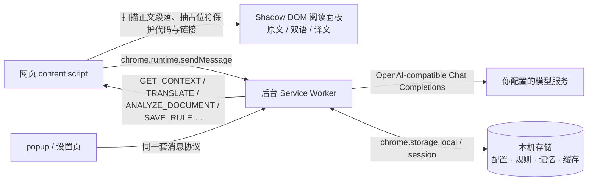

# Tandem Reader

> 中文名（曾用名）：**文档译读**

面向 Chrome / Edge 的技术文档对照阅读扩展。使用自己的模型接口与 API Key，在原网页中就地译出双语对照，并在同一套文档里保持术语一致。产品源码使用 TypeScript，翻译运行时接入 Pi Agent。

A Manifest V3 browser extension that keeps your own model endpoint and API key, renders translations next to the original technical documentation, and remembers terminology and domain context so the same term stays consistent across a documentation set.

## 特性

- **就地对照**：译文叠加在原文段落之后，原文永不删除；`原文 / 双语 / 译文` 三种显示模式随时切换，切换不会重新调用模型。
- **只处理正文**：段落、标题、列表、表格与引用；代码块、行内标识符与链接原样保留，链接仍可点击。
- **术语规则**：选中原文术语即可设为「保留英文 / 指定译法 / 首次中英对照」，作用范围可选当前页面、这套文档、领域或全部文档。
- **领域记忆**：自动识别文档领域与关键术语（附原文依据），也可手动补充；同一文档集的新章节继续补充术语，改动领域会清理该范围旧的自动术语。
- **自备模型**：DeepSeek、智谱 GLM 或任意 OpenAI-compatible Chat Completions 接口，Key 可只存本次会话或记住在本机。
- **没有中转**：扩展直接访问你填写的接口地址，不经过任何第三方服务器。
- **可诊断**：设置页「诊断」区可查看并导出最近 200 条脱敏事件（时间、请求类型、耗时、错误分类）。

## 安装

1. 打开 Chrome 的 `chrome://extensions` 或 Edge 的 `edge://extensions`。
2. 开启「开发者模式」，点击「加载已解压的扩展程序」。
3. 选择本项目的 **`extension` 文件夹**，不是项目根目录。
4. 将扩展固定到浏览器工具栏，打开扩展设置，添加模型连接。

本地 ZIP 包已包含可加载的 `extension`；从源码开始时，请先按照下方开发说明安装依赖并构建。修改源码后重新构建，在扩展管理页点击刷新，再刷新要翻译的网页。本项目是本地开发版本，尚未提交浏览器扩展商店。

## 模型配置

在设置页选择 DeepSeek、智谱 GLM 或「自定义兼容接口」，填写自己的 API Key，保存配置后点击「测试已保存的配置」。内置选项会填入官方地址与默认模型；模型 ID 仍可修改，服务商推出新模型后可以直接输入。

| 模型服务 | 直接连接的 Base URL | 默认模型 |
| --- | --- | --- |
| [DeepSeek 官方](https://api-docs.deepseek.com/guides/codex) | `https://api.deepseek.com` | `deepseek-flash` |
| [智谱 GLM 官方](https://docs.bigmodel.cn/cn/guide/models/free/glm-4.7-flash) | `https://open.bigmodel.cn/api/paas/v4` | `glm-4.7-flash` |
| 自定义兼容接口 | 由你填写 | 由你填写 |

内置连接直接访问所选服务商，扩展没有中转服务器。GLM 预设使用智谱开放平台的标准 API；专门的 Coding Plan 地址不属于该预设。使用其他网关、本地模型或其他兼容服务时，选择「自定义兼容接口」。协议均为 OpenAI-compatible Chat Completions，这与选择哪家模型服务是两件事。

选择服务商会清空尚未保存的 Key。编辑已有连接时，同一接口留空可保留原 Key；更换接口地址后需要重新填写，不会自动把原来的 Key 发送到新地址。旧备份未记录服务商时，会根据确切的官方地址识别 DeepSeek / GLM，其他地址作为自定义接口。

为减少逐段翻译的等待，内置 DeepSeek 的上述模型以及 GLM-4.7 / GLM-4.7-Flash 使用关闭思考的请求参数。GLM-5.3 / GLM-5.3-Flash 按官方要求保留思考并使用 `low` 强度；其他模型 ID 使用服务端默认值。自定义接口不附加服务商特有的思考参数。[DeepSeek 思考模式说明](https://api-docs.deepseek.com/guides/thinking_mode/)、[GLM 思考模式说明](https://docs.bigmodel.cn/cn/guide/capabilities/thinking-mode)、[GLM-5.3 接口说明](https://docs.bigmodel.cn/cn/guide/models/text/glm-5.3)。

- 自定义 Base URL 填服务商提供的 API 根地址，例如 `https://api.example.com/v1`；内置服务商的地址不可修改。
- 接口需要支持 `POST /chat/completions` 和文本对话消息；仅支持其他协议的服务不能只通过更换 Key 接入。
- 可以使用提供兼容接口的本地服务。HTTP 仅用于 `localhost` / `127.0.0.1`；远程服务使用 HTTPS。
- API Key 可以只保存于浏览器会话，也可以记住在本机。浏览器扩展存储不是加密保险箱；本项目不使用同步存储，不把 Key 放入网页内容或普通配置导出。
- 领域分析、翻译与连接测试会直接请求你配置的模型服务，并可能产生该服务商的费用。自动分析会发送文档标题、章节与最多 12000 字符的正文样本；逐段翻译会发送当前文本、领域提示及同一文档的近期翻译上下文。

## 使用

打开英文技术文档，点击工具栏按钮并选择已保存的连接。默认开启「自动识别领域和术语」：开始翻译后，先从正文样本分析领域、背景与术语含义，再逐段翻译。界面会显示分析状态；可在原文、双语、译文之间切换，切换阅读模式不会重新调用模型。

选中原文中的术语后，可保留英文、指定译名、设置首次中英对照，或跳过所在段落。保存时检查作用范围：当前页面、这套文档、某个领域或所有文档。「这套文档」以显示的网址路径为准。

同一术语按「当前页面 → 最长匹配的文档路径 → 领域 → 全局」选择规则。匹配忽略大小写，按完整词或短语匹配；`agent` 不会匹配 `agentic`，`agent` 与 `agents` 需要分别设置。规则生效后，后续翻译遵循新偏好；已生成的译文按界面提示更新。规则可在设置页管理。首次中英对照按当前页面的段落顺序判断，后续出现保留英文。

译文显示在原文旁边。代码保留格式，链接保留原始文本和可点击性；首版不翻译链接标签。原网页中的链接、代码与其他原始结构保留。模型输出按文本处理，不作为 HTML 执行。原文仍是核对技术含义的依据。

翻译请求只把当前段落作为待译正文，文档标题和章节仅提供背景。若模型仍把译文包在已知 JSON 字段中，扩展会提取正文后再校验术语和代码；无效包装会显示可重试错误。原文本身是 JSON 示例时保留完整结构。升级此修复后首次启动会清理旧格式的译文缓存和近期会话，保留模型配置、Key、术语与领域记忆；请刷新扩展并重新打开或刷新文档页面。

自动识别取正文开头、中间、结尾的样本，并结合标题和章节判断语境，不是仅凭 `agent` 一个词推断。术语必须在样本中出现，并附有原文证据；自动分析可能仍有误，设置页会展示建议译法、含义和依据。「纠正为人工规则」会预填规则表单，检查后保存即可覆盖自动译法。

同一模型配置和人工上下文下，文档样本未变时复用已记住的分析，不重复请求；同一文档集的新章节会补充术语，识别到不同领域时会清理该范围内旧的自动术语。分析失败会提示并继续使用当前设置翻译；停止时不会把尚未完成的分析写入记忆。可在弹窗关闭自动识别，或在设置页删除某条自动领域记忆。

你可以随时修改领域与阅读提示。人工术语、页面记忆、文档集记忆和本次阅读的明确设置优先于自动建议。只有实际修改上下文并勾选「记住在这套文档」后，开始翻译才会保存人工记忆；直接使用自动结果不会把它悄悄升级为人工设置。设置页也可以单独添加当前页面的人工记忆。

配置导入会替换模型列表、术语和阅读偏好，以及文件中包含的人工领域记忆。旧版备份未包含领域记忆时会保留现有记录。导入文件不包含 Key，仅同 ID、同接口地址且保存方式相同的已有 Key 会被保留。自动领域分析、段落跳过记录与近期段落会话不包含在配置导出中。

设置页的「诊断」区可查看或导出最近 200 条结构化记录：时间、请求类型、任务标识、耗时与错误分类。这些记录只存在扩展后台的内存中，不含页面原文、译文或 API Key，浏览器或扩展重载后即清空；需要排查问题时可直接附上导出的 JSON。

## Agent 与记忆

项目使用固定版本的 [`@earendil-works/pi-agent-core` 1.2.0](https://github.com/earendil-works/pi/tree/main/packages/agent) 和 `@earendil-works/pi-ai`。翻译请求通过真正的 `Agent.prompt()`、会话状态和事件生命周期运行；已有段落会恢复为 Agent 的用户与助手消息，再处理当前段落。自定义传输适配器继续使用兼容性较广的非流式 `/chat/completions` 接口。当前未开放自主工具调用，也没有安装 Pi 编程 CLI。

Pi Agent 负责运行中的消息状态和生命周期，跨后台重启的持久化由扩展自己的 `MemoryRepository` 与 `chrome.storage.local` 实现。这里的记忆包括：

| 记忆 | 行为与边界 |
| --- | --- |
| 个人术语 | 保存保留英文、指定译法、首次中英对照等明确偏好。 |
| 人工领域记忆 | 最多 100 条页面或文档集背景；页面优先，其次最长匹配的文档路径。可查看、编辑、删除。 |
| 自动领域记忆 | 最多 50 个文档集，每个集最多 80 个术语和 20 个文档指纹。保存领域背景、建议译法、含义与原文依据，与人工规则分开存储。 |
| 近期段落会话 | 最多保留 30 个文档会话，每个会话最近 3 对原文与通过校验的译文。每侧最多 4000 字符，超过限制时整对不写入，不截成半句话。 |

近期会话按页面与模型配置、接口地址、领域背景、规则版本等共同隔离，配置变化后不会把旧上下文套到新的请求。失败、已取消和仍含内部占位符的结果不会作为有效段落记忆保存。后台 Service Worker 被浏览器回收后，会从本机存储恢复近期上下文。

这些会话包含文档原文与译文，自动领域记忆包含术语的原文依据，均保存在本机，不进行云同步，也不进入配置备份。设置页「近期文档会话 → 清除所有近期会话」会清除会话和翻译缓存，同时保留领域记忆、术语与模型配置。删除某条领域记忆可使用该记录旁的删除按钮；自动识别保持开启时，下次阅读会重新分析已删除的自动记忆。

## 首版范围

- HTML 网页中的技术文档正文。
- Chrome / Edge Manifest V3 扩展。
- 自备 OpenAI-compatible 模型服务、多连接配置、双语阅读、术语规则与文档记忆。

目前不支持 PDF、Word、浏览器内部页或扩展商店页面。不保证处理所有网页布局、跨域 iframe、封闭 Shadow DOM 和复杂在线编辑器。翻译仍可能出错；应按具体文档调整领域说明和术语规则。

## 架构

### 运行时形态



- **content script**（`src/content`）：页面侧的事——找到正文段落、把代码与链接抽成占位符、把译文渲染进 Shadow DOM 面板、处理选中术语的菜单。原文与译文都留在页面 DOM 里，原文不删除，关闭面板即恢复原样。
- **后台 Service Worker**（`src/background`）：配置与规则、模型调用与缓存、领域分析、记忆读写都在这里；后台被浏览器回收后从本机存储恢复，近期上下文不丢。
- **popup / 设置页**（`src/ui`）：通过同一套消息协议操作后台。网页里的脚本读不到 Key 与配置。
- **模型服务**：由你在设置页填写，扩展不提供中转服务器；未授权的域名无法访问。

### 消息与状态

- `src/shared/protocol.ts` 是所有消息类型与输入输出的唯一来源（`Requests` / `Pushes`），并用 `as const satisfies` 加 `assertNeverUnhandled` 保证「新增消息类型必须有实现」，否则编译期报错。
- content、popup 与设置页统一走 `send<K extends RequestType>()`；后台不再手写字段级 `typeof` 校验，改用 `requireNonEmptyText` / `requireText` / `requireTextList`。
- content 的运行状态是判别联合（`idle | loading | analyzing | translating | stopped | error`），用 `RunToken` 引用比较丢弃过期回调；渲染映射拆成 DOM-free 的 `toolbarView` / `blockView` 与 `renderToolbar` / `renderBlock`。

### 存储布局

| 位置 | 键 | 内容与生命周期 |
| --- | --- | --- |
| `chrome.storage.local` | `settings`、`profiles`、`rules`、`skips`、`revision` | 阅读偏好、模型连接、术语规则、跳过段落；`revision` 让在途的过期翻译结果失效。 |
| `chrome.storage.local` | `localKeys`、`documentSessions`、`domainMemories` | 选择「记住在本机」的 Key、近期段落会话、自动领域记忆。 |
| `chrome.storage.local` | `schemaVersion` | 迁移版本；`src/background/migrations.ts` 按序幂等执行，旧版本兼容由 `translationFormatVersion` 判断。 |
| `chrome.storage.session` | `sessionKeys`、`allowed:<tabId>`、`context:<tabId>`、`cache:<hash>`、`job:<jobId>` | 会话 Key、页面启用授权、本次阅读的领域覆盖、翻译缓存与在途任务；浏览器关闭即清空。 |
| 内存 | 诊断环形缓冲 | 最近 200 条脱敏事件，不落盘。 |

### 权限与隐私

- 申请的权限：`activeTab`、`scripting`、`storage`；接口域名通过 `optional_host_permissions` 在你保存配置时按需授权，内置服务商之外的自定义接口同样需要授权。
- 存储访问级别设为 `TRUSTED_CONTEXTS`：网页里的脚本读不到扩展存储，只有后台与扩展页面可读。
- Key 不进入配置导出、不进入诊断事件、不写入网页；更换接口地址时不会自动沿用旧 Key。
- 发送给模型的内容限于当前段落、标题与章节背景、适用术语，以及同一文档的近期翻译上下文；不发送整页 HTML 或浏览历史。
- 「诊断」记录只保留 `{时间, 请求类型, 标签页, 任务标识, 阶段, 耗时, 是否成功, 错误分类}`，`record()` 只复制这份白名单字段，多传的字段会被丢弃。

## 开发与构建

需要 Node.js **22.19 或更新版本**。依赖版本与锁文件已固定，源码不包含用户密钥：

```sh
npm ci
npm run build
npm run build:watch
npm run typecheck
npm test
npm run package
```

`npm test` 直接用 Node 的类型剥离运行 `src/**` 的单元测试，不需要先构建。`npm run build` 执行严格 TypeScript 检查并生成扩展产物（不生成 sourcemap），`npm run build:watch` 在开发时监听源码并持续重建（生成 sourcemap，仅供本地调试）。`npm run package` 在 `dist` 中生成 `tandem-reader-<version>.zip`（当前 `0.5.0`）；打包前会校验 manifest 版本与 `package.json` 一致，且产物中不含 sourcemap 或测试文件。编译后的 JavaScript 是浏览器需要加载的产物；修改业务逻辑时应编辑 TypeScript 源文件。

| 目录 | 用途 |
| --- | --- |
| `src/agent` | Pi Agent 集成与 OpenAI-compatible 传输适配器。 |
| `src/memory` | 可注入存储的文档记忆与会话仓库。 |
| `src/shared` | 消息类型、服务商预设、术语匹配、占位符与配置校验。 |
| `src/background`、`src/content`、`src/ui` | 扩展后台、网页阅读交互与配置界面。 |
| `public` | Manifest、扩展图标、HTML 与 CSS 静态资源（`manifest.json` 的版本号是 `__VERSION__` 占位符，构建时注入）。 |
| `extension` | 构建生成的可加载扩展，不作为业务源码编辑。 |
| `tests` | Node 单元测试（直接运行 `src/**`）、`tests/browser` 隔离浏览器测试、fixtures 与截图产物。 |
| `scripts` | `build.mjs`（生产 / `--watch` 构建与版本注入）、`package.mjs`（打包预检与 ZIP）。 |
| `docs` | 设计与重构文档（历史提案，含更名说明）。 |

可选浏览器测试需要已构建扩展，以及已安装的 Playwright 和 Chromium：

```sh
npm run test:browser
```

如果 Playwright 位于其他目录，将环境变量 `PLAYWRIGHT_MODULE` 设置为该包的目录。脚本不会安装依赖。

浏览器验证使用独立临时 Chromium 配置与本机模拟模型服务，不访问个人浏览器数据，不调用真实付费模型。DeepSeek / GLM 请求由测试拦截为固定响应，并屏蔽对应域名的 DNS 解析。测试副本预授权这些模拟接口，用于替代无头环境无法点击的浏览器原生权限提示；正式扩展仍按需申请接口域名权限。测试截图保存在 `tests/artifacts`。

单元测试覆盖领域分析证据校验、人工术语优先、自动记忆隔离与容量边界、服务商接口、译文 JSON 包装、真实 Pi Agent 的事件与恢复状态，以及文档记忆仓库。浏览器测试覆盖分析先于翻译、分析复用与新章节补充、失败回退与取消、自动识别开关，以及原有的服务商配置、双语阅读、术语、JSON 示例、密钥隔离、缓存迁移和后台重启恢复。

模拟测试不能证明真实模型翻译质量、浏览器原生权限提示交互或任意服务商兼容性。测试中的「模拟译文」是固定响应，不代表真实翻译效果。

实际接入后，建议用自己的 Key 完成一次连接测试和短段落翻译，再检查 `agent` 等领域术语是否符合预期。

## 打包与发布

```sh
npm run build      # 严格类型检查 + 生成 extension/（生产构建，无 sourcemap）
npm run package    # 再生成 dist/tandem-reader-<version>.zip（含 extension/、README.md 与 LICENSE）
```

版本号只有一个来源：`package.json` 的 `version`。`public/manifest.json` 中写 `__VERSION__` 占位符，构建时替换；`npm run package` 在打包前校验 manifest 版本与 `package.json` 一致、`extension/` 中没有 sourcemap、也没有测试文件，任一不满足都会以非零状态退出。

发布一个带可加载 ZIP 的 GitHub Release：

```sh
git tag -a v0.5.0 -m "Tandem Reader 0.5.0"
git push origin main --tags
# 再在 GitHub 网页上 New release → 选择 v0.5.0 → 上传 dist/tandem-reader-0.5.0.zip → 填写更新说明（可用 CHANGELOG.md 的 0.5.0 一节）
```

扩展已带图标（`public/icon-{16,32,48,128}.png`，几何占位设计，可按品牌替换）。提交浏览器扩展商店前还需要：商店文案与截图、隐私政策页；当前仓库以本地开发版本发布，尚未提交商店。

仓库自带两个 GitHub Actions：`.github/workflows/ci.yml` 在 push / PR 时执行类型检查、单元测试与生产构建；`.github/workflows/browser.yml` 在 push 到 `main`、手动（Actions → Run workflow）或每周自动运行浏览器冒烟测试，会自动安装 Playwright、构建扩展并上传 `tests/artifacts` 截图。

各版本变更见 [CHANGELOG.md](CHANGELOG.md)。

## 许可证

[MIT](LICENSE)。本项目依赖的 `@earendil-works/pi-agent-core` 与 `@earendil-works/pi-ai` 同为 MIT；随扩展分发的第三方声明见 `THIRD_PARTY_NOTICES.txt`。
