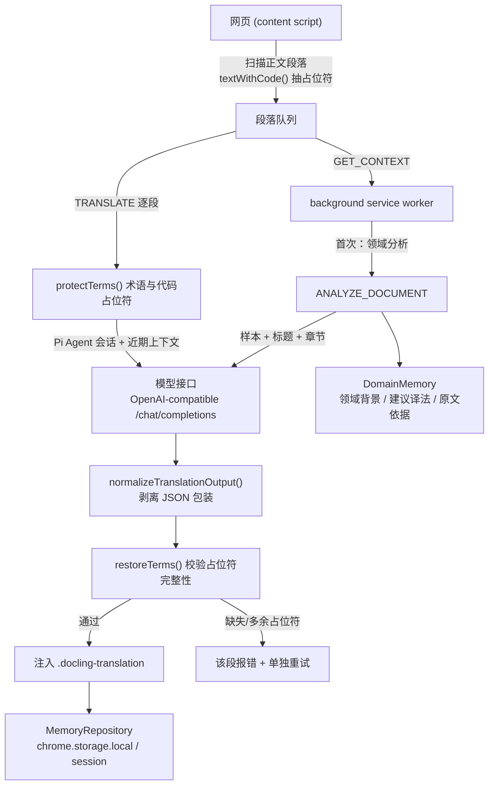
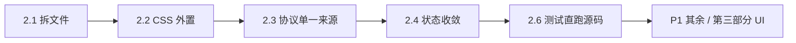

# 文档译读 · 重构提案

> **更名说明（重构后补记）**：项目已更名为 **Tandem Reader**（包名 `tandem-reader`）。本文档写于更名之前，正文中的「文档译读」即当前产品名；第二部分 2.1–2.9 已在 0.4.0 之后落地。
> 版本基线：`tandem-reader@0.4.0`（当时的包名 `document-translator-extension`）
> 性质：**只读侦察之后的书面提案**。本文档不修改任何源码，只描述「现在是什么样」「可以怎么改」。
> 交付要求：①项目理解；②工程（项目级）重构思路；③页面内 UI/UX 重构方案。

## 0. 关于参考站点的说明（必须先披露）

上一轮对话中给出的参考站点
`https://hoihky.github.io/csharp-notes/maf/maf-site/3-tools-and-safety/02-tool-approval-human-in-loop.html`
本次**未能访问**：第一次抓取被客户端拦截（域名解析到保留地址），第二次重试未获授权。

因此本文第三部分的 UI/UX 提案依据的是：

1. 本插件自身注入到网页的 DOM 与 CSS（`public/content.css`、`src/content/index.ts` 内的 Shadow DOM 样式表）；
2. 通用技术文档站的常见结构（`article`/`main` 正文、粘性目录侧栏、行内 `code`、callout、表格、`pre` 代码块）；
3. 仓库内已有的测试夹具（`tests/fixtures/technical-document.html`）与浏览器冒烟测试断言。

凡是「针对该站点具体样式」的判断，本文都标注为**待现场验证**。若需要精确结论，请把该站点页面另存为 HTML 放到 `tests/fixtures/`，我可以据此复核。

---

## 一、这个项目在做什么

### 1.1 一句话定位

**文档译读**是一个 Chrome / Edge Manifest V3 扩展，用**你自己配置的模型接口和 API Key**，把英文技术文档就地翻译成可对照阅读的双语页面，并在阅读过程中积累**领域记忆**与**术语规则**，让同一个词在整套文档里保持一致。

它不做「整站替换式机翻」，而是：

- 只处理**正文段落级**元素（`CANDIDATES = 'p, h1..h6, li, td, th, figcaption, blockquote'`，见 `src/content/index.ts:47`）；
- 明确**排除**导航、页眉页脚、表单、`pre`/`code`、`contenteditable` 等（`EXCLUDED`，`src/content/index.ts:48`）；
- 把**代码、行内标识符、链接**抽出为占位符，翻译后原样还原；
- 原文**永不删除**，译文是叠加进去的（`原文 / 双语 / 译文` 三种显示模式）。

### 1.2 数据流



要点在于：**后台是唯一的可信执行者**，网页端只负责 DOM 与交互；模型输出必须先过「包装剥离 → 占位符校验」两道关，否则宁可报错也不显示。

### 1.3 已实现的核心能力（按重要性）

| 能力 | 实现位置 | 说明 |
| --- | --- | --- |
| 逐段双语注入 | `src/content/index.ts:406` `prepareBlock()` | 块级元素在段落之后插入译文；`li/td/th/blockquote/figcaption` 用 `span[data-docling-wrapper]` 包裹原文再追加译文，避免破坏列表/表格结构 |
| 三档显示模式 | `content.css:1` / `content.css:5` | 通过 `html[data-docling-mode]` + `data-docling-source` 属性切换，纯 CSS，不重新请求模型 |
| 领域自动识别 | `src/shared/domain-analysis.ts`、`src/background/index.ts:164` | 取正文首/中/尾样本 + 标题 + 最多 30 个章节；分析结果带**原文证据**，无证据的术语被丢弃；同一指纹复用不重复请求 |
| 术语规则体系 | `src/shared/core.ts` `applicableRules()` / `protectTerms()` | 四种作用域 `page > collection > domain > global`，按具体度排序去重；`keep / translate / first`（首次中英对照）三种动作；词边界匹配（`agent` 不匹配 `agentic`） |
| 占位符保护 | `core.ts` `protectTerms()` / `restoreTerms()` | 术语用 `[[DTR_<nonce>_n]]`、代码与链接用 `[[DOC_CODE_n]]`；要求模型原样且**恰好出现一次**，否则整段失败 |
| 分层记忆 | `src/memory/repository.ts` | 个人术语、人工领域记忆（≤100 条）、自动领域记忆（≤50 文档集 / 每集 ≤80 术语 + ≤20 文档指纹）、近期段落会话（≤30 会话 × 最近 3 对，每侧 ≤4000 字符，超限整对不写） |
| 缓存与格式版本迁移 | `background/index.ts:16` `ready`、`translation-output.ts` | 升级输出解析格式后清空旧译文缓存与近期会话，**保留**模型配置、Key、术语、领域记忆 |
| 密钥处理 | `background/index.ts:45` `readKeys()` | 支持「仅本次会话」与「记住本机」；`storage.accessLevel = TRUSTED_CONTEXTS`，网页上下文读不到 |
| 危险操作防护 | `background/index.ts:62` `isUi()` / `:70` `authorizedPage()` | 消息按来源区分 UI 与页面；需要页面的操作走 `requirePage()` 校验；接口域名走 `chrome.permissions` 授权 |

### 1.4 工程形态（客观评价）

**做得好的地方**（这些是重构时必须保住的资产）：

- 输入校验非常严格：后台对每个入参都做类型 + 长度检查（例如 `analyzeDocument` 里对 `sample ≤ 12000`、`headings ≤ 30 × 200` 的逐项校验），错误信息是**面向用户的中文**而不是堆栈。
- 并发与一致性有防护：`controllers` Map 做任务抢占、`serialWrite()` 做写序列化、`revision` 字段做「设置变更后拒绝写入」的乐观并发校验。
- 记忆容量有硬边界且可测试，`tests/memory.test.cjs` 覆盖了边界行为（超限整对不写、跨作用域记录丢弃等）。
- 测试是**行为级**的，不是覆盖率摆设：48 个用例覆盖术语优先级、导出信封解析、自动记忆隔离、Pi Agent 事件与恢复。
- 无框架依赖：content 脚本零运行时依赖（除了 Pi Agent 在后台），对网页的性能与兼容性影响小。

**拖后腿的地方**：

- 三个「大文件」：`src/content/index.ts` 796 行、`src/background/index.ts` 581 行、`src/ui/options.ts` 532 行，各自把扫描/状态机/UI/调度/持久化揉在一个作用域里。
- 消息协议是字符串 + 手写校验，`OK/error` 信封在三个地方各写一遍。
- content 侧状态是一个可变的 `state` 对象 + 手动 `render()`，`running/busy/phase/generation/jobId` 五个字段的组合合法性全靠人脑维护。
- UI 是「一个浮窗面板 + 段落注入」，没有把「阅读」当作首要场景来设计（详见第三部分）。

---

## 二、工程重构思路

按「投入产出比」从高到低排列。**建议分批做，每批都能独立验证，不要一次性大爆炸。**

### P0 · 低风险、立刻改善可维护性

#### 2.1 拆分三个大文件（纯搬运，不改行为）

| 现状 | 建议目标 |
| --- | --- |
| `src/content/index.ts`（796 行） | `content/dom.ts`（`element`/`button`/`textWithCode`/`restoreCode`/`readableRoot`/`isVisible`）、`content/scan.ts`（`scanBlocks`）、`content/translate.ts`（`prepareBlock`/`translateBlock`/`retryBlock`/`stopTranslation`）、`content/theme.ts`（Shadow DOM 样式表字符串，见 2.2）、`content/toolbar.ts`、`content/selection-menu.ts`、`content/index.ts`（只做装配与消息监听） |
| `src/background/index.ts`（581 行） | `background/store.ts`（`readData`/`readKeys`/`serialWrite`/迁移）、`background/router.ts`（`handle` 的 switch）、`background/page-context.ts`（`effectiveSettings`/`pageContext`/`notifyPages`）、`background/tasks.ts`（`analyzeDocument`/`translate`/`translateRequest`/`complete`/缓存）、`background/rules.ts`（`saveRule`/`skips`）、`background/index.ts`（只做注册） |
| `src/ui/options.ts`（532 行） | 按 options.html 的四个 section 拆成 `ui/options/models.ts`、`terms.ts`、`data.ts`、`memory.ts` + 一个共享 `ui/dom.ts`（现在 `$()`、渲染函数散在各处） |

理由：这是**零行为风险**的改动（搬运 + 导出），但能让后续所有改动便宜一个数量级。验证方式：`npm test` 全绿即可。

#### 2.2 把 Shadow DOM 样式表移出 TS

现状：`src/content/index.ts:174-208` 是一段模板字符串 CSS，被塞在脚本逻辑中间，无法 lint、无法预览、改动容易破坏转义。

建议：放 `src/content/toolbar.css`，用 esbuild 的 `loader: { '.css': 'text' }` 在构建时内联为字符串；或退一步放 `src/content/styles.ts` 导出常量。收益：可被编辑器高亮/格式化，也方便第三部分的样式重构。

#### 2.3 给消息协议一个单一事实来源

现状：`'TRANSLATE'`、`'GET_CONTEXT'`… 这类字符串散落在 `content`、`ui`、`background` 三处；后台对每个字段手写 `typeof` 校验（例如 `analyzeDocument` 里 5 个字段的校验分支）。

建议：

```ts
// src/shared/protocol.ts
export interface Requests {
  TRANSLATE: { input: TranslationRequest; output: { text: string; cached: boolean } };
  ANALYZE_DOCUMENT: { input: AnalysisRequest; output: { context: PageContext; reused: boolean; warning?: string } };
  // ...
}
```

配一个轻量运行期校验器（不需要引 zod；`shared/core.ts` 已有的 `normalizeText` 风格足够），签名统一为：

```ts
send<K extends keyof Requests>(type: K, payload: Requests[K]['input']): Promise<Requests[K]['output']>
```

收益：新增一种消息时**编译期**报错；删掉后台里成片的重复校验；顺带让 `tests/*.test.cjs` 更容易构造数据。

#### 2.4 content 侧状态收敛

现状：`state` 是单个可变对象，`phase: 'idle' | 'loading' | 'analyzing' | 'translating'` 与 `running`/`busy` 存在语义重叠（`startTranslation` 里要同时维护三者），`generation` 计数器用来丢弃过期回调。

建议：

- 用**判别联合**描述状态，让非法组合无法构造：

```ts
type RunState =
  | { kind: 'idle' }
  | { kind: 'loading'; run: RunToken }
  | { kind: 'analyzing'; run: RunToken }
  | { kind: 'translating'; run: RunToken; total: number; done: number; failed: number }
  | { kind: 'stopped'; run: RunToken }
  | { kind: 'error'; run: RunToken; message: string };
```

- `generation: number` 换成 `run: RunToken`（`{ id, jobId, startedAt }`），`isCurrentRun(run)` 变成引用比较，比数字自增更难用错。
- `render()` 保持「整块重绘 + 幂等」的简单策略（当前做法是对的，**不要**引入响应式框架），但把「状态 → DOM」的映射拆成 `renderToolbar(status)` / `renderBlock(block)` 两个纯函数，便于单测。

#### 2.5 存储 schema 版本化

现状：`background/index.ts:16` 的 `ready` 是一次性迁移（`translationFormatVersion`），未来第二次迁移会开始长分支。

建议：改成迁移表：

```ts
const migrations: Array<{ to: number; run: () => Promise<void> }> = [
  { to: 1, run: async () => { /* 清旧缓存与会话 */ } },
  // 未来追加
];
```

配 `chrome.storage.local` 中的 `schemaVersion`，顺序执行且**幂等**。收益：升级路径可测试（`tests/memory.test.cjs` 的 `validateMemories` 风格）。

### P1 · 中期收益

#### 2.6 测试可以直接跑源码

现状：`npm test` = `npm run build && node --test tests/*.test.cjs`，测试依赖 `.test-build/` 中间产物（`scripts/build.mjs` 最后一步专门为测试打包）。改一行源码必须先构建，反馈慢；测试实际上测的是打包结果。

建议：Node 22 已支持类型剥离，可以 `node --experimental-strip-types --test tests/*.test.cjs`（或引入 `tsx`/`vitest`）直接跑 `src/**`，`.test-build` 只作为兼容保留。这一步能显著提升后续重构速度。

#### 2.7 冒烟测试拆场景

现状：`tests/browser-smoke.cjs` 591 行，一个 `main()` 里起 mock server、注入 manifest、跑 10+ 个场景、最后统一断言，失败时定位成本高。

建议：`tests/browser/{harness.cjs, providers.cjs, memory-scenarios.cjs, ui-scenarios.cjs}`，harness 提供 `withExtension(fn)`/`startMockModel(routes)` 复用，每个场景一个 `test()`。顺带把 `tests/artifacts/*.png` 的截图更新成断言的一部分（第三部分会大量改 UI，这些断言是回归网）。

#### 2.8 构建产物与版本一致性

现状：`scripts/build.mjs` 手动串 esbuild；`extension/` 在 `.gitignore`；版本号在 `package.json` 与 `public/manifest.json` 各写一遍（当前都是 0.4.0，但靠人维护）。

建议：

- `--watch` 开发模式（esbuild `context().watch()`），改完自动重建，配合扩展页「刷新」即可；
- 仅开发构建输出 sourcemap；
- 版本号单一来源：`build.mjs` 读 `package.json` 注入 manifest（manifest 里用占位符或构建时改写）；
- `package.mjs` 打包前校验：manifest 版本 == package.json 版本、`extension/` 里不存在 `.map`、不存在 `*.test.*`。

#### 2.9 诊断面板（可观测性）

现状：出错只在面板/popup 里显示一行文本，用户报障时无法提供上下文。

建议：后台维护一个**环形缓冲**（最近 N=200 条结构化事件：`{ at, type, tabId, jobId, phase, durationMs, ok, errorCode }`，**不含原文/译文/Key**），设置页新增「诊断」区：查看 + 导出 JSON（脱敏）。这是低成本、高回报的运维能力。

### P2 · 视产品方向决定

#### 2.10 主题与设计令牌统一

现在 `ui.css`（options/popup）与 content 的 Shadow DOM 样式表各自维护一套颜色（`--accent:#1c6b5b` vs `#286751`、`#468a77`），同一个产品出现三种绿。建议抽 `src/shared/tokens.ts`（或 CSS 变量文件）生成两个上下文各自需要的形态，同时天然支持深色模式（见 3.2）。

#### 2.11 首版范围之外的接口预留

README 已明确不支持 PDF/Word/跨域 iframe/封闭 Shadow DOM。建议在 `content/dom.ts` 里把 `readableRoot()` 与 `scanBlocks()` 的**目标抽象**成 `TranslationTarget` 接口，未来接 PDF.js 或选区翻译时不用改状态机。

#### 2.12 无障碍与键盘路径

当前已有 `role="status"`/`aria-live="polite"`（`content/index.ts:228`）、`aria-pressed`（`:235`）、`aria-expanded`（`:220`）等基础，但缺：面板焦点管理、`prefers-color-scheme`、快捷键。第三部分会展开，工程上建议把「快捷键表」也做成单一事实来源，popup/设置页/文档共用。

### 工程重构的执行顺序建议



每一批都以「`npm test` 全绿 + `npm run test:browser` 通过」为完成标准；UI 相关批次额外比对 `tests/artifacts/` 截图。

---

## 三、页面内 UI/UX 重构方案（重点）

目标不是「把面板做好看」，而是：**让界面服务于「读一篇很长的技术文档」这件事**。

### 3.1 现状诊断（基于源码事实）

| # | 现象 | 证据 | 对阅读的影响 |
| --- | --- | --- | --- |
| 1 | 译文是**块级追加**在原文之后 | `content.css:9` `.docling-translation { display:block; margin:0.4em 0 1.2em }` | 段落一长，原文与译文的视线距离就变远；段落一多，「对照」实际退化成「上一段是什么来着」 |
| 2 | 模式切换是**全局**的 | `content.css:1` / `content.css:5` 基于 `html[data-docling-mode]` | 用户只想让「当前这一段」显示原文时，只能切整页模式 |
| 3 | 工具栏固定右下、尺寸固定 | `content/index.ts:187` `.toolbar { right:20px; bottom:20px; width:min(390px,…) }` | 直接压在文档站的右下角（返回顶部、目录、AI 助手等常驻此处）；`compact`（`:204`）只是收起正文，仍是 155px 宽的浮窗 |
| 4 | 进度只有一行文字 | `render()` 中 `progress.textContent = 正在翻译 x / y 段` | 长文档无法「跳到第一个失败的段落」；失败信息会随滚动被丢弃 |
| 5 | 术语交互依赖**选中 + 弹菜单** | `selectionMenu()`（`:664`）→ `positionMenu()`（`:656`） | 菜单只往选区**下方**放（`rect.bottom + 8`），贴近视口底部时会遮挡后续正文；规则保存后正文里**没有持久标记**，看不到「这个词我配置过」 |
| 6 | 段落级操作默认**全部可见** | `outputTools()`（`:429`）每段渲染「查看原文 / 不翻译这段」 | 一屏内重复出现十几个按钮，是最主要的视觉噪声来源 |
| 7 | 术语变更后的反馈是「整页变旧」 | `markStale()`（`:444`）+ `data-docling-state="stale"` | 改一个词导致**所有**已译段落被标记为过期并等待「更新译文」，代价与收益不匹配 |
| 8 | 无阅读位置记忆 | 状态中只有 `pageUrl`/`blocks`，无滚动位置 | 关闭标签页再打开，等于从零开始（对长文档是硬伤） |
| 9 | 深色模式未适配 | `content/index.ts:175` `:host { color-scheme: light; }`；`content.css` 全为浅色硬编码 | 在深色文档站上是一块突兀的浅色贴片；`ui.css` 同样只有浅色令牌 |
| 10 | 列表/表格内的译文缩进易错位 | `prepareBlock()` 用 `span[data-docling-wrapper]` + `content.css:62` `display:contents` | 编号列表的译文可能脱离序号层级；表格单元格内译文撑高行（**待现场验证**，需真实站点复核） |
| 11 | 未配置模型时只有一行提示 | `startTranslation()` 中 `state.message = '请先打开设置…'` | 首次使用者拿不到「下一步做什么」 |

### 3.2 方案一：阅读布局层 —— 把「对照」做成真的对照

**① 行内对照档位（最高优先级）**

短段落（建议：原文 ≤ 2 行或 ≤ 120 字符，可配置）不再块级堆叠，而是**句内/行内紧跟**：

```css
.docling-translation[data-docling-layout="inline"] {
  display: inline;
  margin: 0 0 0 0.35em;
  padding: 0;
  border: 0;
  background: none;
  color: color-mix(in srgb, currentColor 78%, transparent);
  font-size: 0.97em;
}
```

视觉上优先用**次级文字色 + 无背景**（而不是色块）来区分原文与译文，长段落仍然块级。判据是「一段话如果用户必须上下扫视，就说明这段太长了」。

**② 状态色条与语义解耦**

现在左色条 `#468a77` 既是「这是译文」又是装饰（`content.css:9`），而 `error`（`:26`）与 `stale`（`:31`）只在状态变化时才换色。建议：

- 译文**默认无边框**（或仅 2px 极浅色条）；
- 色条专用于**状态**：`pending` 灰、`stale` 琥珀、`error` 红，并在同一位置提供可点击的图标（点击 = 重试 / 更新该段）；
- 颜色全部走 CSS 变量，随主题切换。

**③ 深色与主题跟随**

```css
:host { color-scheme: light dark; }
@media (prefers-color-scheme: dark) {
  .docling-translation { background: rgba(255,255,255,.05); border-left-color: #5da58e; }
}
```

再补一个「跟随站点 / 强制浅色 / 强制深色」的三态选项（默认跟随系统）。这也顺带解决 `ui.css` 与 Shadow DOM 两套令牌合一（工程 2.10）。

**④ 结构保真**

列表项译文用**同级 `<div>` 缩进到内容列**（而不是塞在 `span` 里），或给 wrapper 加 `display: contents` 之外的显式 `list-style: none` 处理，保证编号与缩进不乱。表格单元格内译文限制为「单元格内第二行、字号 0.95em、`overflow-wrap: anywhere`」。**这一步必须在真实站点上比对，不能凭推断定稿。**

### 3.3 方案二：阅读辅助层 —— 新增真正帮助阅读的能力

**① 段落导轨（Reading Rail）** ★ 本提案我最推荐的一项

在视口**右缘贴一条 6px 的极细导轨**，为每个段落画一个 2px 刻度：

- 颜色 = 段落状态（未译 / 已译 / 失败 / 过期）；
- hover 显示该段原文前 60 字；
- 点击滚动定位到该段落；
- 实现用 `IntersectionObserver` 维护可见段落集合，**不要**在滚动时逐个 `getBoundingClientRect()`（长文档会掉帧）；
- 可一键隐藏。

这是把「翻译进度」从一行文字升级为**空间化的阅读地图**，也是长文档场景下最缺的一块。

**② 阅读位置记忆**

复用后台已有的记忆通道，新增 `readingProgress`（按页面 URL 存 `{ scrollY, anchorBlockId, at }`，容量上限比如 200 条）：

- 重新打开文档时，在导轨上标出「上次读到这里」，并提供一键跳回（**不自动滚动**，避免打断）；
- popup 中提供「清除阅读位置」。

**③ 术语在正文里显形**

已保存的术语规则在原文中加**弱标记**（`text-decoration: underline dotted` + `text-underline-offset: 3px`，颜色用 `color-mix` 弱化），hover/聚焦显示浮层：当前动作为「保留英文 / 译名 X / 首次对照」+「改作用域」+「取消这条规则」。这比「先选中再弹菜单」更贴合阅读节奏 —— 读到别扭的词时，鼠标停一下就能改。

注意实现成本：需要一次全量文本扫描（`relevantRules` 已存在的规则集合），必须限定在当前可见块，并且**只用 `Range` 包裹标记，不改文本节点内容**，否则会破坏 `textWithCode()` 的占位符一致性。建议做成可关闭的实验特性。

**④ 选区菜单升级**（保留现有能力）

- 位置：默认放选区**上方**（`rect.top - height - 8`），视口空间不足自动翻转到下方，并强制完整落在视口内（`positionMenu()` 现在是「单向下 + 夹取」）；
- 键盘：`Tab`/`Shift+Tab` 循环、`Enter` 提交、`Esc` 关闭（`Esc` 已有）；
- 「解释这里的含义」的结果：现在是 `max-height: 240px; overflow: auto` 的 `<p>`（`content/index.ts:202`），建议加复制按钮 + 折叠，并允许「把这条解释保存为该术语的上下文说明」（直接喂给下一次翻译的 `context`）；
- 术语变更后的旧译文处理：**不要**整页 `stale`。改为「只标记包含该术语的段落为过期」，精度提升后 `markStale()` 的提示语也要相应改成「N 段包含这个词，已标记待更新」。

**⑤ 段落级工具降噪**

`outputTools()`（`:429`）的按钮默认 `opacity: 0`，段落 `:hover` 或 `:focus-within` 时显示；键盘用户通过 `Tab` 仍可到达（`:focus-within` 保证可达性），并在导轨或工具栏提供「显示全部段落操作」开关。失败段落的按钮**永远可见**（错误不能藏在 hover 里）。

**⑥ 键盘路径**

| 快捷键 | 作用 |
| --- | --- |
| `Alt+Shift+T` | 开始 / 继续翻译 |
| `Alt+Shift+M` | 循环切换 原文 → 双语 → 译文 |
| `Alt+Shift+R` | 跳到下一个未完成 / 失败段落 |
| `Alt+Shift+U` | 应用待更新译文（替代现在的「更新译文」按钮） |
| `Esc` | 关闭面板 / 菜单（已有） |

快捷键在设置页可查看与关闭；不要在输入框内触发（检查 `event.target`）。

**⑦ 迷你大纲**

从当前正文的 `h2/h3` 生成一个可折叠的小目录（仅在文档有 ≥3 个标题时出现），点击滚动。它与站点自己的目录**并存但不重叠**，定位在工具栏内（展开态），而不是再占一条固定栏位 —— 避免和站点 TOC 打架（这是很多翻译插件的通病）。

### 3.4 方案三：控制面层 —— 工具栏与 popup 的职责划分

**① 工具栏重定位与避让**

- 默认位置改为**右缘垂直居中**（不挡「返回顶部」「目录」），并且**可拖拽**，位置记忆到 `chrome.storage.local`；
- 自动避让：检测页面是否存在右/左侧粘性目录（`aside`、`[role=navigation]`、宽 > 1280px 时的常见选择器），命中则贴内侧；检测不到就留出 20px 安全边距；
- `compact`（`:204`）重定义为**状态胶囊**：只显示一个状态点 + 进度环（例如 `◍ 12/40`），点击展开；不再保留 155px 的中间态。

**② 信息层级：先状态，后配置**

当前工具栏首屏同时出现：标题、收起/关闭、领域、状态、三个模式按钮、四个操作按钮、一句提示（`content/index.ts:210-240`）。建议分层：

```
┌───────────────────────────────┐
│ 文档译读        ◍ 12/40   ⌄  × │   ← 状态优先
│ [原文][双语][译文]  [暂停]     │   ← 当前操作
│ 领域：AI Agent / .NET  ·  详情 ▸│   ← 折叠次要信息
└───────────────────────────────┘
```

- 「详情」展开后才显示：分析状态、术语数量、阅读提示、快捷键、导轨开关；
- 进度用 `<progress>`（popup 已用）+ 文本，失败计数可点击跳转（配合导轨）。

**③ 首次使用引导**

未配置模型时，面板内直接呈现三步（1 打开设置 → 2 选择服务商填 Key → 3 测试连接），主按钮调用 `OPEN_OPTIONS`（已存在，`content/index.ts` 中 `settingsButton`），并监听 `GET_CONTEXT` 的 `profileConfigured` 变化自动回到「可以开始了」。**不要**只在状态行显示一行红字。

**④ popup 与页面面板分工**

- **popup**：回答「这次阅读怎么翻」（模型、领域、阅读提示、自动识别开关、模式）—— 现有结构已经不错（`public/popup.html`）；
- **页面面板**：回答「现在进行到哪、我要改哪一段」；
- 两者共享 `GET_STATUS` / `GET_CONTEXT`，不要各自维护一份状态渲染逻辑。

**⑤ 无障碍**

- 面板：`role="dialog"` + `aria-label`（已有 `aria-label="文档译读阅读工具"`），展开/收起时管理焦点（进入面板首元素、关闭后回到触发点）；`aria-expanded`（已有）保持同步；
- 导轨：`role="navigation"` + `aria-label="段落导航"`，每项是 `button` 且带 `aria-label`（含段落状态与序号）；
- 译文区域：`lang` 已正确设置（`prepareBlock()` 中按 `targetLanguage` 计算），补 `aria-label`；
- 提供「读屏时隐藏译文」开关（对屏幕阅读器用户，双语正文是双重噪声）。

**⑥ 窄屏**

`width: min(390px, calc(100vw - 24px))`（`:187`）在窄屏下已接近全宽，建议 < 720px 时改为**底部抽屉（bottom sheet）**，并可下滑关闭。

### 3.5 落地清单（可直接转成任务）

| # | 改动点 | 现位置 | 目标 | 优先级 |
| --- | --- | --- | --- | --- |
| 1 | 短段落行内对照 | `content.css:9` | 新增 `data-docling-layout="inline"` 档位 | P0 |
| 2 | 状态色条与语义色变量 | `content.css:9/26/31` | 色条只表状态，颜色走变量 | P0 |
| 3 | 段落操作降噪 | `outputTools()` `:429` | hover/focus 显示，失败段常显 | P0 |
| 4 | 选区菜单位置翻转 | `positionMenu()` `:656` | 上方优先 + 视口内翻转 | P0 |
| 5 | 工具栏可拖拽/记忆/避让 | `.toolbar` `:187` | 右缘居中 + 拖拽 + 避让 TOC | P0 |
| 6 | 工具层级重排 | `:210-240` | 状态优先，详情折叠 | P1 |
| 7 | 段落导轨 | 新增 | 空间化进度 + 跳转 | P1 |
| 8 | 阅读位置记忆 | 新增 | 断点续读 | P1 |
| 9 | 术语正文显形 | 新增（实验） | hover 编辑作用域 | P1 |
| 10 | 深色模式 | `:175`、`ui.css` | 跟随系统 + 三态开关 | P1 |
| 11 | 过期限定到相关段落 | `markStale()` `:444` | 只标记含该术语的段落 | P1 |
| 12 | 键盘快捷键 | 新增 | 5 个快捷键 + 设置页开关 | P2 |
| 13 | 迷你大纲 | 新增 | 工具栏内折叠目录 | P2 |
| 14 | 首次使用引导 | `startTranslation()` | 三步引导 + 自动继续 | P2 |
| 15 | 窄屏底部抽屉 | `.toolbar` `:187` | < 720px 时的形态 | P2 |

### 3.6 如果只能做三件事

1. **段落导轨 + 短段落行内对照** —— 直接解决「读长文档」这个主场景的核心痛点；
2. **工具栏避让 / 可拖拽 / 状态优先** —— 消除「插件挡住文档站自己的 UI」这一最强负反馈；
3. **术语在正文中显形 + 键盘路径** —— 把「边读边纠正」从三步操作变成一步。

---

## 四、风险与验证

| 风险 | 说明 | 缓解 |
| --- | --- | --- |
| 破坏站点样式 | 新增行内/结构改动可能影响列表、表格、`pre` 周边 | 所有改动限定在 `[data-docling-*]` 命名空间内；不修改原文文本节点（只加属性/包裹）；在 ≥3 个真实文档站（Docusaurus / MkDocs / learn.microsoft.com）回归 |
| 无障碍回归 | 面板结构变化会破坏现有 `aria-*` 断言 | `tests/browser-smoke.cjs` 中的选择器断言同步更新，并新增导轨的键盘可达性断言 |
| 性能 | 导轨与术语显形若按段落实时测量会掉帧 | `IntersectionObserver` + `requestIdleCallback` 分批；限定在可见块 |
| 测试截图失效 | `tests/artifacts/*.png` 会随 UI 改动全部变化 | 把截图更新纳入改动流程，并加文本断言（不能只看图） |
| 术语显形与占位符冲突 | 标记可能与 `[[DOC_CODE_n]]` / `[[DTR_*]]` 互相干扰 | 显形只作用于 `block.source` 的文本节点，且在 `translateBlock()` 前后都要求能还原原始 `textWithCode()` 结果；做成可关闭特性，默认在 P1 之后评估 |
| 深色模式对比度 | 语义色（琥珀/红）在深色下可能不足 4.5:1 | 用 `light-dark()` 定义两套令牌，CI 中加一条对比度自检（可脚本化） |

**验收方式**：`npm run check`（= `npm test` + `npm run test:browser`）全绿 + 真实站点人工核对（长文档滚动、列表、表格、深色、键盘全流程）。

---

## 五、本次侦察依据

- 源码：`src/agent/{chat-completions,translation-agent}.ts`、`src/background/index.ts`(581)、`src/content/index.ts`(796)、`src/memory/repository.ts`(278)、`src/shared/{core,domain-analysis,providers,translation-output,types}.ts`、`src/ui/{popup,options}.ts`(198/532)
- 静态资源：`public/{manifest.json,content.css,ui.css,popup.html,options.html}`
- 构建与测试：`scripts/{build,package}.mjs`、`tests/*.test.cjs`（48 例）、`tests/browser-smoke.cjs`(591)、`tests/fixtures/*`
- 说明：`README.md`、`package.json`、`.gitignore`

本文档只描述提案，**未修改任何源码**。若采纳，建议按 2.1 → 2.4 的工程改造先落地，再进行第三部分的 UI 重构 —— 后者需要前者提供的可测试性，否则「改一点、验证半天」会拖垮节奏。
